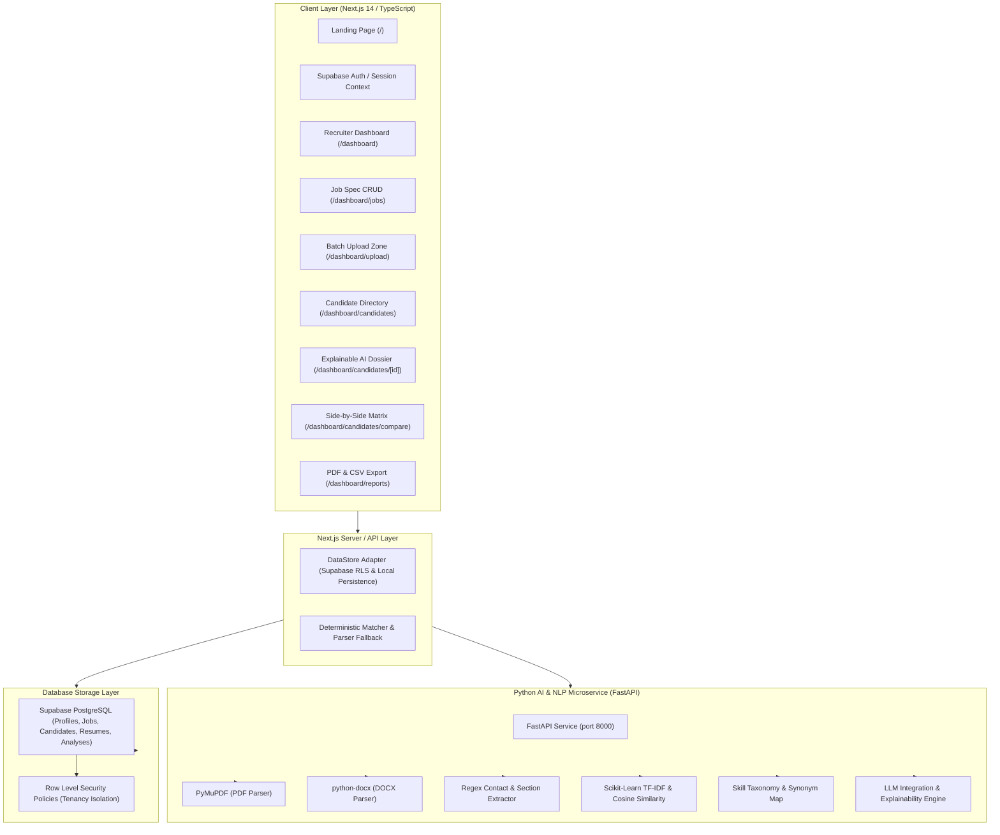

# HireSense AI — System Architecture & Methodology

## 1. High-Level Architecture Diagram

---

## 2. Explainable 5-Factor Scoring Methodology

HireSense AI calculates an alignment score from **0 to 100** based on the following deterministic weighted formula:

$$\text{Overall Score} = (S_{\text{req}} \times 0.40) + (S_{\text{pref}} \times 0.15) + (S_{\text{exp}} \times 0.20) + (S_{\text{proj}} \times 0.15) + (S_{\text{edu}} \times 0.10)$$

### Component Weights & Explanations:

1. **Required Skill Coverage ($40\%$)**:
   - Calculates the ratio of mandatory required skills present in the resume.
   - Exact and normalized synonym mapping (e.g., `React.js` $\leftrightarrow$ `React`, `k8s` $\leftrightarrow$ `Kubernetes`, `NodeJS` $\leftrightarrow$ `Node.js`).
   - If missing, flagged explicitly as **"Not found in resume"** rather than assuming a lack of competence.

2. **Preferred Skill Coverage ($15\%$)**:
   - Evaluates bonus competencies that enhance candidate suitability.
   - If the job posting specifies zero preferred skills, the candidate is awarded $100\%$ baseline for this dimension to prevent penalty.

3. **Relevant Experience Alignment ($20\%$)**:
   - Extracts numeric years of experience from timeline headers and summary statements.
   - If candidate years $\ge$ required years $\rightarrow 100\%$.
   - If candidate years $<$ required $\rightarrow \text{Score} = \max\left(25, \frac{\text{Years}_{\text{candidate}}}{\text{Years}_{\text{required}}} \times 100\right)$.

4. **Project & Work History Evidence via TF-IDF ($15\%$)**:
   - Vectorizes resume project/experience sentences against the job description using `scikit-learn` `TfidfVectorizer(stop_words='english')`.
   - Computes cosine similarity of term frequency vectors combined with project count heuristics.

5. **Education & Certification Alignment ($10\%$)**:
   - Detects degree keywords (`Bachelor`, `Master`, `B.Tech`, `M.S.`, `Ph.D.`, `Diploma`).
   - Matches candidate degree specialization with job prerequisites.

---

## 3. Responsible AI & Anti-Bias Framework

- **Zero Demographic Weights**: Age, gender, ethnicity, race, religion, disability, photograph, and marital status are strictly excluded from parsing and scoring.
- **Traceability**: Every score component displays supporting textual citations directly extracted from the applicant's resume lines.
- **Decision Support, Not Decision Maker**: All match scores are explicitly labeled as **decision-support indicators**. The recruiter reviews the evidence and makes the final human hiring determination.
